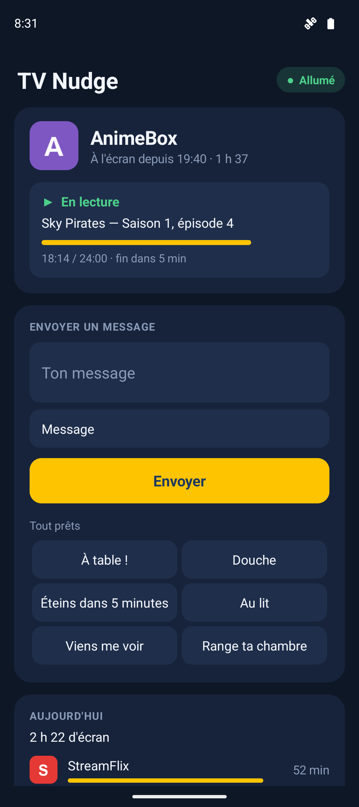
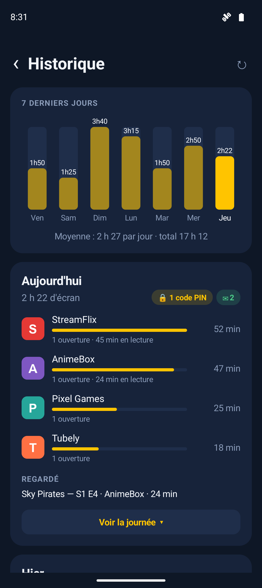
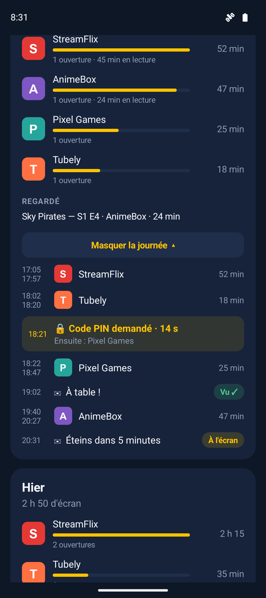

# TV Nudge

Envoyer un message sur la télé que regarde votre enfant, et voir ce qui passe.

TV Nudge comprend deux applications Android qui communiquent par le Wi-Fi de la maison :

- **l'app télé**, sur un Fire TV d'Amazon : elle affiche votre message par-dessus le programme et note ce qui se passe sur la télé ;
- **l'app téléphone** : elle envoie les messages et montre ce qui se passe sur la télé, en direct et jour par jour.

Rien ne sort de votre réseau : pas de compte, pas de serveur, pas de pistage.

*[English version](README.md)*

| En direct | Historique jour par jour | Le détail d'une journée |
|---|---|---|
|  |  |  |

*Les captures utilisent des apps et des données inventées.*

## Fonctions

- **Messages par-dessus l'image.** Tapez un message ou choisissez-en un tout prêt (« À table ! », « Éteins dans 5 minutes »). Il s'affiche sur la télé avec un bip. Un appui sur OK de la télécommande le marque comme vu. Le téléphone indique s'il a été vu, fermé avec Retour ou ignoré.
- **En direct** : télé allumée ou en veille, app à l'écran et depuis quand, ce qui est en lecture (état et position ; titre et temps restant quand l'app les partage).
- **Temps d'écran** : le total du jour et le temps passé dans chaque app.
- **Historique**, jour par jour :
  - un graphique sur 7 jours ;
  - les apps ouvertes et pendant combien de temps ;
  - les titres regardés, quand l'app les partage ;
  - les demandes de code PIN du contrôle parental, et l'app ouverte juste après ;
  - les messages envoyés et leur état.

## État du projet et limites

Projet jeune, fait pour une famille et partagé tel quel.

- **Matériel testé :** un Fire TV Stick 4K (Fire OS 7) avec un téléphone Android 13. Les autres Fire TV et Android TV devraient fonctionner, mais n'ont pas été testés.
- **Langue :** l'interface et les commentaires du code sont **en français** pour l'instant.
- **Pas encore de sécurité :** n'importe qui sur votre Wi-Fi peut lire l'historique et afficher un message sur la télé. À utiliser uniquement sur un réseau de confiance.
- **Pas de titre avec Netflix :** Netflix ne partage que l'état de la lecture et la position, ni le titre ni la durée.
- **Résultat du code PIN inconnu :** le Fire TV note que l'écran du code s'est affiché, pas si le code était bon.
- **Peu d'historique au départ :** Android ne garde son journal d'usage qu'environ une semaine. TV Nudge le recopie toutes les 5 minutes : l'historique s'allonge à partir du jour de l'installation.

## Installation

Pour l'instant, il faut [adb](https://developer.android.com/tools/adb) sur un ordinateur, une seule fois, et le Fire TV et le téléphone sur le même Wi-Fi.

Téléchargez `tv-nudge-tv-<version>.apk` et `tv-nudge-phone-<version>.apk` depuis la [dernière version](https://github.com/FMagnanWD/tv-nudge/releases/latest), ou compilez-les vous-même (voir plus bas).

1. Sur le Fire TV, ouvrez **Paramètres → Ma Fire TV → À propos** et cliquez 7 fois sur le nom de l'appareil. Puis, dans **Options pour les développeurs**, activez **Débogage ADB**.
2. Notez l'adresse IP du Fire TV dans **Paramètres → Ma Fire TV → À propos → Réseau**.
3. Installez l'app télé et donnez-lui ses autorisations. Fire OS n'a pas d'écran de réglage pour ces autorisations :

   ```sh
   adb connect <IP_DU_FIRE_TV>:5555
   adb install -r tv-nudge-tv-0.1.0.apk
   adb shell appops set io.github.tvnudge.tv SYSTEM_ALERT_WINDOW allow    # afficher par-dessus les autres apps
   adb shell appops set io.github.tvnudge.tv GET_USAGE_STATS allow        # app à l'écran, temps d'écran
   adb shell settings put secure enabled_notification_listeners io.github.tvnudge.tv/io.github.tvnudge.tv.EcouteLecture   # lecture en cours
   adb shell am broadcast -n io.github.tvnudge.tv/.Demarrage              # démarre le service sans rien ouvrir à l'écran
   ```

   Le service redémarre seul quand le Fire TV s'allume.
4. Installez `tv-nudge-phone-0.1.0.apk` sur le téléphone (autorisez l'installation depuis le navigateur ou le gestionnaire de fichiers quand il le demande). Ouvrez-le et saisissez l'adresse IP du Fire TV en bas de l'écran.
5. Vous pouvez ensuite désactiver le débogage ADB : les autorisations restent.

## Compilation

```sh
./gradlew :tv:assembleDebug :phone:assembleDebug
```

Il faut le JDK 17 et le SDK Android. Android Studio fournit les deux. Les APK sont dans `tv/build/outputs/apk/debug/` et `phone/build/outputs/apk/debug/`. Une version debug ne peut pas mettre à jour une version publiée (signatures différentes) : désinstallez d'abord.

Pour signer des versions release avec votre propre clé, voir [`gradle/signature.gradle`](gradle/signature.gradle).

## API (port 7979 du Fire TV)

L'app du téléphone utilise cette petite API HTTP. Vous pouvez aussi l'appeler depuis un script, une box domotique ou un raccourci, par exemple avec [`tools/send.sh`](tools/send.sh).

| Requête | Réponse |
|---|---|
| `POST /message` `{"texte": "...", "titre": "Message", "duree": 60, "son": true}` | `{"id": 3}`. `GET /message?texte=...&titre=...` fait la même chose. |
| `GET /etat?id=3` | `affiché`, `vu` (OK), `fermé` (Retour), `expiré`, `remplacé` ou `inconnu` |
| `GET /statut` | État de l'écran, app à l'écran, lecture en cours, temps par app aujourd'hui, derniers messages |
| `GET /historique?jours=14` | Les derniers jours, du plus récent au plus ancien : séances d'apps (écrans du code PIN marqués `"pin": true`), temps de lecture par titre, messages |
| `GET /icone?paquet=<paquet>` | L'icône de l'app (PNG) |
| `GET /ping` | `{"ok": true}` |

Tant qu'un message est à l'écran, il prend la télécommande : seuls OK et Retour le ferment.

## Feuille de route

- Appairage du téléphone et de la télé (code affiché sur la télé) et échanges chiffrés.
- Détection automatique du Fire TV sur le réseau.
- Assistant d'installation dans l'app du téléphone, qui installerait l'app télé et donnerait ses autorisations par le réseau, sans ordinateur.
- Interface en anglais.
- Expérimental : lire les titres des apps qui ne les partagent pas, grâce au texte d'accessibilité qu'elles exposent.

Les contributions sont bienvenues.

## Licence

[GPL-3.0 ou ultérieure](LICENSE). Vous pouvez utiliser, modifier et partager TV Nudge. Si vous distribuez une version modifiée, vous devez publier son code source sous la même licence.

TV Nudge n'est affilié ni à Amazon, ni à Netflix, ni à aucun service de streaming. Les marques citées appartiennent à leurs propriétaires.
