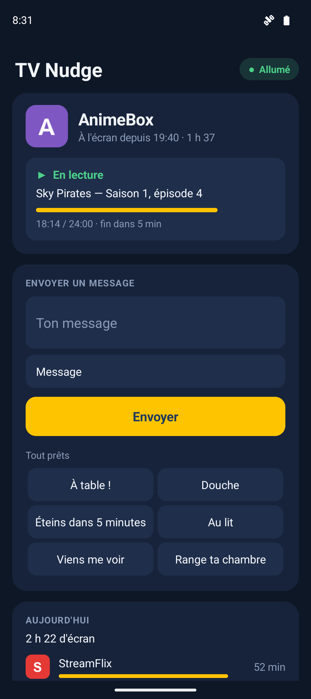
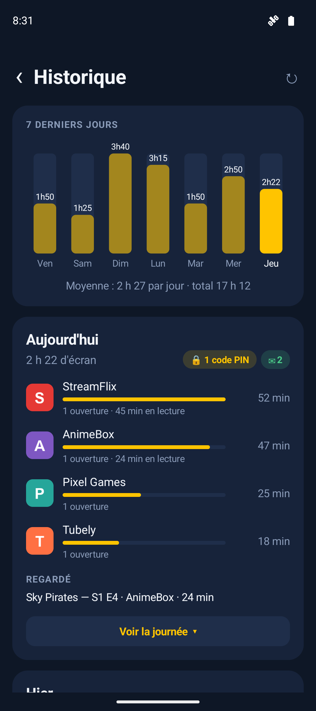
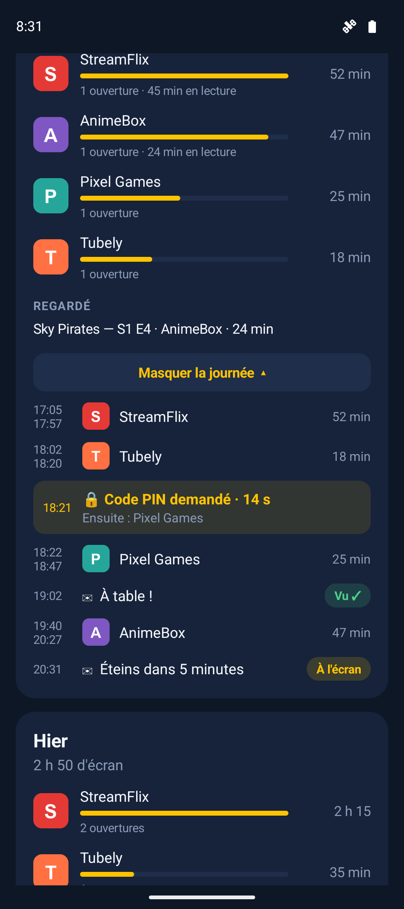

# TV Nudge

Send a message to the TV your kid is watching, and see what is on.

TV Nudge has two Android apps that talk over your home Wi-Fi:

- **TV app**, on an Amazon Fire TV: shows your message over whatever is playing, and keeps track of what happens on the TV.
- **Phone app**: sends the messages and shows what is on the TV, live and day by day.

Nothing leaves your home network: there is no account, no server, and no tracking.

*[Version française](README.fr.md)*

| Live status | Day-by-day history | One day in detail |
|---|---|---|
|  |  |  |

*Screenshots use made-up apps and data.*

## Features

- **Messages over the picture.** Type a message or pick a ready-made one ("Dinner's ready!", "Lights out in 5 minutes"). It pops up on the TV with a beep. Pressing OK on the remote marks it as seen. The phone shows whether it was seen, closed with Back, or ignored.
- **Live status**: TV on or asleep, the app on screen and since when, what is playing (state and position; title and remaining time when the app shares them).
- **Screen time**: today's total and the time spent in each app.
- **History**, day by day:
  - a 7-day chart;
  - the apps opened and for how long;
  - the titles watched, when the app shares them;
  - parental-control PIN prompts, and which app opened right after;
  - the messages sent and their state.

## Status and limits

Early project, built for one family and shared as is.

- **Tested hardware:** a Fire TV Stick 4K (Fire OS 7) with an Android 13 phone. Other Fire TV and Android TV devices will probably work, but they are untested.
- **Language:** the interface and the code comments are in **French** for now.
- **No security yet:** anyone on your Wi-Fi can read the history and show a message on the TV. Use it only on a network you trust.
- **No title from Netflix:** Netflix shares only the playback state and position, not the title or the length.
- **PIN result unknown:** the Fire TV logs that the PIN screen appeared, not whether the code was right.
- **Short past history:** Android keeps its usage log for about a week. TV Nudge copies it every 5 minutes, so the history grows from the day you install it.

## Install

Developers: you need [adb](https://developer.android.com/tools/adb) on a computer, and the Fire TV and the phone on the same Wi-Fi network.

1. On the Fire TV, open **Settings → My Fire TV → About** and click the device name 7 times. Then, in **Developer options**, turn on **ADB debugging**.
2. Find the Fire TV's IP address in **Settings → My Fire TV → About → Network**.
3. Build both apps (see below), then install the TV app and grant it its permissions. Fire OS has no settings screen for these permissions:

   ```sh
   adb connect <FIRE_TV_IP>:5555
   adb install -r tv/build/outputs/apk/debug/tv-debug.apk
   adb shell appops set io.github.tvnudge.tv SYSTEM_ALERT_WINDOW allow    # show messages over other apps
   adb shell appops set io.github.tvnudge.tv GET_USAGE_STATS allow        # app on screen, screen time
   adb shell settings put secure enabled_notification_listeners io.github.tvnudge.tv/io.github.tvnudge.tv.EcouteLecture   # what is playing
   adb shell am broadcast -n io.github.tvnudge.tv/.Demarrage              # start the service without opening anything on screen
   ```

   The service starts again by itself when the Fire TV boots.
4. Install `phone/build/outputs/apk/debug/phone-debug.apk` on the phone. Open it and enter the Fire TV's IP address at the bottom of the screen.
5. You can turn ADB debugging off again: the permissions stay.

## Build

```sh
./gradlew :tv:assembleDebug :phone:assembleDebug
```

You need JDK 17 and the Android SDK. Android Studio provides both.

## API (port 7979 on the Fire TV)

The phone app uses this small HTTP API. You can also call it from a script, a home-automation system or a shortcut, for example with [`tools/send.sh`](tools/send.sh).

| Request | Answer |
|---|---|
| `POST /message` `{"texte": "...", "titre": "Message", "duree": 60, "son": true}` | `{"id": 3}`. `GET /message?texte=...&titre=...` does the same. |
| `GET /etat?id=3` | `affiché` (on screen), `vu` (OK pressed), `fermé` (Back pressed), `expiré`, `remplacé` or `inconnu` |
| `GET /statut` | Screen state, app on screen, what is playing, today's time per app, last messages |
| `GET /historique?jours=14` | The last days, newest first: app sessions (PIN screens have `"pin": true`), playback time per title, messages |
| `GET /icone?paquet=<package>` | The app's icon (PNG) |
| `GET /ping` | `{"ok": true}` |

While a message is on screen, it takes over the remote: only OK and Back close it.

## Roadmap

- Pairing between the phone and the TV (a code shown on the TV) and encrypted exchanges.
- Finding the Fire TV on the network automatically.
- A setup assistant in the phone app, which would install the TV app and grant its permissions over the network without a computer.
- English interface.
- Experimental: read titles from apps that don't share them, through the accessibility text they expose.

Contributions are welcome.

## License

[GPL-3.0-or-later](LICENSE). You may use, modify and share TV Nudge. If you distribute a modified version, you must publish its source code under the same license.

TV Nudge is not affiliated with Amazon, Netflix or any streaming service. All trademarks belong to their owners.
